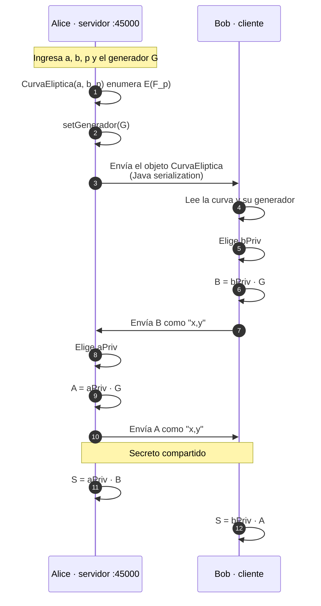

# Diffie-Hellman sobre curva elíptica

<div align="center">

**Práctica 2 · Intercambio de claves ECDH implementado a mano**

[](https://www.oracle.com/java/)
[](https://netbeans.apache.org/)
[](https://www.oracle.com/java/)
[](../LICENSE)

`Temas Selectos de Criptografía` · Grupo 7CM2 · ESCOM · IPN

[← Volver al índice](../README.md)

</div>

---

## 📖 Contexto

Intercambio de claves ECDH completo entre **dos procesos que se comunican por
TCP**, con **toda la criptografía implementada a mano**: no se usa ninguna
biblioteca criptográfica, ni la JCA. La aritmética de la curva elíptica
(suma y doblado de puntos), el algoritmo de Euclides extendido para los inversos
modulares y el propio protocolo ECDH están escritos desde cero.

El objetivo es comprobar el resultado algebraico del intercambio:

$$
a \cdot (b \cdot G) \;\equiv\; b \cdot (a \cdot G) \pmod p
$$

es decir, que ambas partes derivan **el mismo secreto a partir de información
pública**, sin haberse enviado jamás las claves privadas.

> Este proyecto tiene un gemelo en
> [`../DiffieHellmanCurvaEliptica/`](../DiffieHellmanCurvaEliptica/): mismas
> cinco clases, distinto `package` y distinto build. Ver
> [Estado del repositorio](#-estado-del-repositorio).

---

## 🔄 Cómo funciona



### Puntos clave del protocolo

- **Alice es el servidor** (`ServerSocket(45000)`) y **Bob el cliente**
  (`Socket("127.0.0.1", 45000)`). Hay que lanzarlos en ese orden, en dos
  terminales.
- La curva viaja como **objeto Java serializado**: la clase `CurvaEliptica`
  implementa `Serializable`, así que Bob recibe directamente los campos `a`,
  `p` y el arreglo `Generador` sin tener que capturarlos a mano.
- Los puntos públicos sí viajan como **texto**, con el formato `"x,y"`, y se
  separan con `split(",")` al recibirlos.
- El transporte es **TCP en claro**. La confidencialidad del secreto no viene
  del canal, sino de que $a$ y $b$ nunca se transmiten. En un contexto real
  faltaría autenticar a las partes para resistir un ataque de man-in-the-middle.

### La multiplicación escalar

Tanto `A = aPriv · G` como `S = aPriv · B` se calculan **sumando el punto `G`
consigo mismo** `k-1` veces mediante `SumaPuntos.sumarPuntos`, que decide si
debe doblar o sumar:

```java
for (int i = 0; i < kprva - 1; i++) {
    aux = sumador.sumarPuntos(Generador[0], Generador[1], aux[0], aux[1], a, p);
}
```

`sumarPuntos` es un despachador: si los dos puntos coinciden llama a `DobPun`
(pendiente de la tangente) y si no a `sumPun` (pendiente de la secante).

---

## 🚀 Cómo ejecutarlo

### NetBeans

Abre `Diffie-Hellman/` en NetBeans. Este proyecto tiene **dos clases con
`main`**, así que NetBeans ofrece elegir cuál ejecutar al presionar <kbd>F6</kbd>.
Necesitas **dos terminales**:

1. `Alice` (servidor) — se queda esperando
2. `Bob` (cliente) — se conecta

### Ant

```bash
cd Diffie-Hellman
ant run
```

### Ejecución directa

El `main.class` declarado en `nbproject/project.properties` apunta a
`diffie.hellman.DiffieHellman`, **una clase que no existe**. Para correrlo hay
que indicar la clase real:

```bash
javac -d out $(find src -name "*.java")

# terminal 1 — servidor
java -cp out diffie.hellman.Alice

# terminal 2 — cliente
java -cp out diffie.hellman.Bob
```

---

## 🎮 Cómo se usa

**Alice** pide primero los datos de la curva y el punto generador:

```
Bienvenido al programa Alice
Programa hecho por Leizu
---------------------------------------------------------------------------
Primero ingrese los datos de la curva eliptica a trabajar
Ingrese el valor de a:
Ingrese el valor de b:
Ingrese el valor de p:
--------------------------------------------------
Puntos de la curva eliptica:
(1,6) (1,7)
...
(Punto al Infinito)
Elige un punto de la curva
Valor de x:
Valor de y:
Servidor iniciado esperando conexion del cliente
Elige tu llave privada...
Key Priv:
```

**Bob** se conecta y pide su clave privada:

```
Esperando a que el servidor conteste
--------------------------------------------------
Puntos de la curva eliptica:
(1,6) (1,7)
...
Elige tu llave privada...
Key Priv:
Esperando a leer entero
```

Los dos últimos números que imprime cada proceso son el punto público y el
**secreto compartido**, que deben coincidir.

---

## 🌳 Estructura

```
Diffie-Hellman/
├── build.xml
├── manifest.mf
├── nbproject/
│   ├── build-impl.xml
│   ├── project.properties
│   └── project.xml
└── src/diffie/hellman/
    ├── AEE.java             # Euclides extendido → inverso modular
    ├── Alice.java           # servidor
    ├── Bob.java             # cliente
    ├── CurvaEliptica.java   # modelo de la curva, Serializable, campo Generador
    └── SumaPuntos.java      # sumarPuntos / sumPun / DobPun
```

| Clase | Responsabilidad |
|:--|:--|
| `AEE` | Euclides extendido. Devuelve el inverso modular que usan las fórmulas de la curva. |
| `CurvaEliptica` | Curva + enumeración de puntos. Implementa `Serializable`, expone `a`, `b`, `p` y el arreglo `Generador` con su `setGenerador` y `getP`. |
| `SumaPuntos` | `sumarPuntos` (despachador), `sumPun` (secante) y `DobPun` (tangente). |
| `Alice` | Servidor: elige la curva, genera `A = aPriv·G`, recibe `B` y calcula `S = aPriv·B`. |
| `Bob` | Cliente: recibe la curva, genera `B = bPriv·G`, envía `B`, recibe `A` y calcula `S = bPriv·A`. |

---

## 👤 Autor

**Francisco Uziel Córdova Pichardo** — `@Uziel-Leizu`

---

## 📌 Estado del repositorio

Se documenta tal como está, sin modificar el código:

- **`main.class` inválido.** `nbproject/project.properties` declara
  `main.class=diffie.hellman.DiffieHellman` y esa clase no existe en el
  proyecto. Las clases ejecutables son `diffie.hellman.Alice` y
  `diffie.hellman.Bob`.
- **Gemelo exacto.** Las cinco clases de este proyecto son idénticas —salvo la
  línea `package`— a las de
  [`../DiffieHellmanCurvaEliptica/`](../DiffieHellmanCurvaEliptica/).
- **Java 8 desactualizado.** `javac.source` y `javac.target` son `1.8`, contra
  `19` en los proyectos Maven.
- **Aritmética en `int`.** Con `(int) Math.pow(x, 2)` y `int` en toda la
  aritmética, la implementación desborda para `p` grande; una curva como
  `secp256r1` no cabe en `int`.
- **Multiplicación escalar lineal.** El bucle `for (i = 0; i < k-1; i++)` es
  $O(k)$: el algoritmo real usa *double-and-add* en $O(\log k)$.
- **Streams mezclados.** `ObjectOutputStream` y `BufferedWriter` se escriben
  sobre el mismo socket, que es frágil porque cada uno tampona los bytes de
  forma distinta.
- **`Scanner` sin cerrar** y `Logger` usado solo para volcar la excepción.
