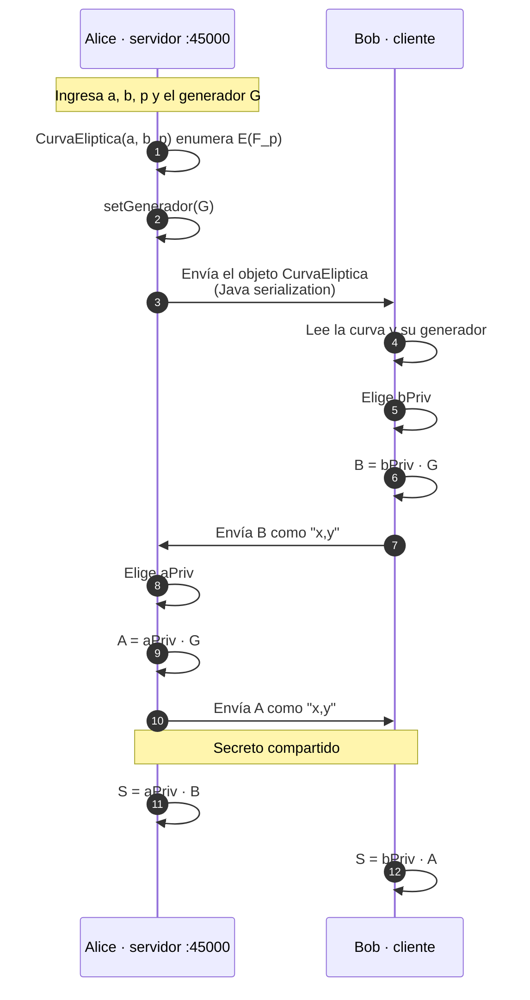

# ECDH sobre curva elíptica — versión Maven

<div align="center">

**Práctica 2 · Intercambio de claves ECDH implementado a mano**

[](https://www.oracle.com/java/)
[](https://maven.apache.org/)
[](https://maven.apache.org/)
[](../LICENSE)

`Temas Selectos de Criptografía` · Grupo 7CM2 · ESCOM · IPN

[← Volver al índice](../README.md)

</div>

---

## 📖 Contexto

El mismo intercambio de claves ECDH del
[`../Diffie-Hellman/`](../Diffie-Hellman/), empaquetado como proyecto **Maven**
en lugar de Ant/NetBeans. Dois procesos se comunican por TCP y acuerdan un
secreto compartido usando únicamente aritmética de curvas elípticas escrita a
mano: sin bibliotecas criptográficas y sin la JCA.

El objetivo es comprobar el resultado algebraico

$$
a \cdot (b \cdot G) \;\equiv\; b \cdot (a \cdot G) \pmod p
$$

es decir, que ambas partes derivan el mismo secreto sin haberse enviado jamás
las claves privadas.

> **Este proyecto y [`../Diffie-Hellman/`](../Diffie-Hellman/) son el mismo
> código.** Las cinco clases coinciden archivo por archivo; lo único que cambia
> es la línea `package` y el sistema de build. Ver
> [Estado del repositorio](#-estado-del-repositorio).

---

## 🔄 Cómo funciona



- **Alice** es el servidor (`ServerSocket(45000)`), **Bob** el cliente
  (`Socket("127.0.0.1", 45000)`). Hay que lanzarlos en ese orden, en dos
  terminales.
- La curva viaja como **objeto Java serializado** —`CurvaEliptica` implementa
  `Serializable`— y los puntos públicos como **texto** con el formato `"x,y"`.
- El transporte va **en claro**: la confidencialidad viene de que $a$ y $b$
  nunca se transmiten. En producción faltaría autenticar a las partes
  (ECDHE autenticado) para resistir ataques de man-in-the-middle.
- La multiplicación escalar `k · G` se hace **sumando el punto consigo mismo**
  `k-1` veces con `SumaPuntos.sumarPuntos`, que decide entre `DobPun` (si los
  puntos coinciden) y `sumPun` (si son distintos).

---

## 🚀 Cómo ejecutarlo

```bash
cd DiffieHellmanCurvaEliptica
mvn clean package
mvn exec:java
```

> El `exec.mainClass` del `pom.xml` apunta a
> `com.studio.diffiehellmancurvaeliptica.DiffieHellmanCurvaEliptica`, **una
> clase que no existe**. Para ejecutarlo hay que indicar la clase real:

```bash
mvn clean compile

# terminal 1 — servidor
java -cp target/classes com.studio.diffiehellmancurvaeliptica.Alice

# terminal 2 — cliente
java -cp target/classes com.studio.diffiehellmancurvaeliptica.Bob
```

---

## 🎮 Cómo se usa

**Alice** pide los datos de la curva, el generador y su clave privada:

```
Bienvenido al programa Alice
Programa hecho por Leizu
---------------------------------------------------------------------------
Primero ingrese los datos de la curva eliptica a trabajar
Ingrese el valor de a:
Ingrese el valor de b:
Ingrese el valor de p:
--------------------------------------------------
Puntos de la curva eliptica:
(1,6) (1,7)
...
(Punto al Infinito)
Elige un punto de la curva
Valor de x:
Valor de y:
Servidor iniciado esperando conexion del cliente
Elige tu llave privada...
Key Priv:
```

**Bob** se conecta y pide su clave privada:

```
Esperando a que el servidor conteste
--------------------------------------------------
Puntos de la curva eliptica:
(1,6) (1,7)
...
Elige tu llave privada...
Key Priv:
Esperando a leer entero
```

Los dos últimos números que imprime cada proceso son su punto público y el
**secreto compartido**, que deben coincidir.

---

## 🌳 Estructura

```
DiffieHellmanCurvaEliptica/
├── pom.xml
└── src/main/java/com/studio/diffiehellmancurvaeliptica/
    ├── AEE.java             # Euclides extendido → inverso modular
    ├── Alice.java           # servidor
    ├── Bob.java             # cliente
    ├── CurvaEliptica.java   # modelo de la curva, Serializable, campo Generador
    └── SumaPuntos.java      # sumarPuntos / sumPun / DobPun
```

| Clase | Responsabilidad |
|:--|:--|
| `AEE` | Euclides extendido. Devuelve el inverso modular que usan las fórmulas de la curva. |
| `CurvaEliptica` | Curva + enumeración de puntos. `Serializable`, con `a`, `b`, `p` y el arreglo `Generador` más su `setGenerador` y `getP`. |
| `SumaPuntos` | `sumarPuntos` (despachador), `sumPun` (secante) y `DobPun` (tangente). |
| `Alice` | Servidor: elige la curva, genera `A = aPriv·G`, recibe `B` y calcula `S = aPriv·B`. |
| `Bob` | Cliente: recibe la curva, genera `B = bPriv·G`, envía `B`, recibe `A` y calcula `S = bPriv·A`. |

---

## 👤 Autor

**Francisco Uziel Córdova Pichardo** — `@Uziel-Leizu`

---

## 📌 Estado del repositorio

Se documenta tal como está, sin modificar el código:

- **`exec.mainClass` inválido.** El `pom.xml` apunta a
  `…diffiehellmancurvaeliptica.DiffieHellmanCurvaEliptica` y esa clase no
  existe. Las ejecutables son `…Alice` y `…Bob`.
- **Gemelo exacto de `../Diffie-Hellman/`.** Mismas cinco clases; solo cambia
  la línea `package` y un comentario de cabecera de NetBeans. Este proyecto usa
  Maven y el otro Ant/NetBeans.
- **Aritmética en `int`.** `(int) Math.pow(x, 2)` e `int` en toda la aritmética
  desbordan para `p` grande; una curva como `secp256r1` no cabe en `int`.
- **Multiplicación escalar lineal.** El bucle `for (i = 0; i < k-1; i++)` es
  $O(k)$: el algoritmo real usa *double-and-add* en $O(\log k)$.
- **Streams mezclados.** `ObjectOutputStream` y `BufferedWriter` sobre el mismo
  socket, frágil porque cada uno tampona los bytes de forma distinta.
- **`Scanner` sin cerrar** y `Logger` usado solo para volcar la excepción.
