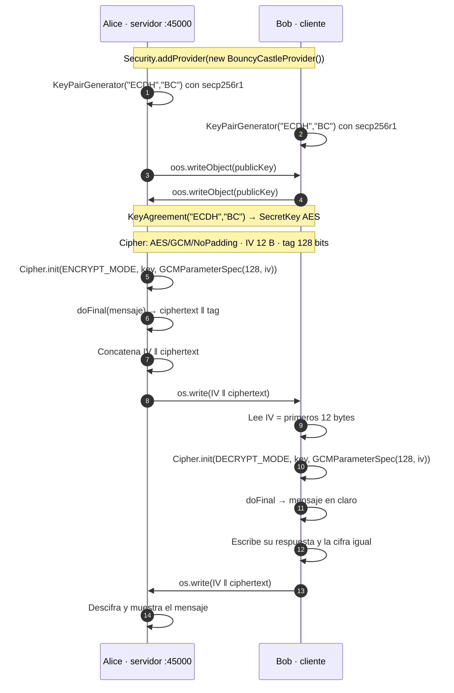

# ECDH + AES-GCM — cifrado híbrido

<div align="center">

**Práctica 3 · Cifrado de extremo a extremo con curva elíptica y AES-GCM**

[](https://www.oracle.com/java/)
[](https://netbeans.apache.org/)
[](https://www.bouncycastle.org/latest_releases.html)
[](../LICENSE)

`Temas Selectos de Criptografía` · Grupo 7CM2 · ESCOM · IPN

[← Volver al índice](../README.md)

</div>

---

## 📖 Contexto

Cifrado **híbrido**: la curva elíptica resuelve el problema del intercambio de
claves y el resultado se usa como llave de sesión para cifrar los mensajes con
un algoritmo simétrico.

Es la forma en que funciona TLS en la vida real. La clave pública de una curva
elíptica es grande y costosa de intercambiar; la clave AES de 128/256 bits
es pequeña y rápida. La solución es usar la primera solo para acordar la segunda.

Aquí el secreto de la curva se usa **directamente** como llave AES. En un
sistema real se aplicaría una función de derivación como HKDF, porque la
salida de ECDH no está uniformemente repartida para todos los bytes.

---

## 🔄 Cómo funciona



---

## 🔐 Los tres detalles que importan

### 1 · La curva elíptica solo acuerda la llave

Cada lado genera su par con `KeyPairGenerator.getInstance("ECDH", "BC")` sobre
la curva **`secp256r1`** (NIST P-256), intercambia su clave pública por el socket
y deriva el secreto con `javax.crypto.KeyAgreement`:

```java
KeyAgreement keyAgreement = KeyAgreement.getInstance("ECDH", "BC");
keyAgreement.init(privateKey);      // mi clave privada
keyAgreement.doPhase(publicKeyPeer, true);  // su clave pública
byte[] sharedSecretBytes = keyAgreement.generateSecret();
```

Bouncy Castle se necesita **precisamente para esto**: el proveedor estándar de
Java no expone `ECDH` como `KeyAgreement`.

### 2 · GCM es autenticado, no solo confidencial

Se usa `AES/GCM/NoPadding` con `GCMParameterSpec(128, iv)`, donde los 128 bits
son el **tag de autenticación**. El tag viaja pegado al ciphertext y se verifica
al descifrar, así que cualquier alteración del mensaje hace fallar el
`doFinal`. Eso da integridad y autenticidad, no solo confidencialidad.

### 3 · El IV viaja con el ciphertext

El **vector de inicialización no es secreto**: quien recibe el mensaje lo
necesita para descifrar. Por eso el código lo concatena al principio del arreglo
enviado:

```java
byte[] encryptedText = new byte[iv.length + cipherText.length];
System.arraycopy(iv,           0, encryptedText, 0,         iv.length);
System.arraycopy(cipherText,   0, encryptedText, iv.length, cipherText.length);
```

y el receptor lo recupera de los primeros 12 bytes. El IV se genera con
`SecureRandom` **en cada envío** y nunca se reutiliza: repetir un IV con la misma
llave rompe por completo la garantía de GCM.

---

## 🚀 Cómo ejecutarlo

### Requisito: Bouncy Castle

Las clases de este proyecto importan `org.bouncycastle.jce.provider.BouncyCastleProvider`,
así que sin la biblioteca no compilan. Las versiones del paquete `-jdk18on`
requieren **Java 8 o superior**.

Descargalas de <https://www.bouncycastle.org/latest_releases.html>. El proyecto
usa ocho archivos:

```
bcprov-jdk18on-173.jar        # el proveedor JCE — imprescindible
bcpkix-jdk18on-173.jar
bcmail-jdk18on-173.jar
bcpg-jdk18on-173.jar
bcjmail-jdk18on-173.jar
bctls-jdk18on-173.jar
bctest-jdk18on-173.jar        # solo pruebas, no hace falta para correr
bc-noncert-1.0.2.4-javadoc.jar
```

> Solo `bcprov` es estrictamente necesario para ejecutar; el resto son módulos
> para PKIX, CMS, S/MIME y TLS.

### NetBeans

Abre `Proyecto1Cripto/` en NetBeans. Este proyecto tiene **dos clases con
`main`**, así que <kbd>F6</kbd> ofrece elegir cuál ejecutar. Necesitas **dos
terminales**: primero `Alice` (servidor) y luego `Bob` (cliente).

Antes de abrirlo, revisa `nbproject/project.properties`: las referencias
`file.reference.*` apuntan a rutas absolutas de otra máquina (ver
[Estado del repositorio](#-estado-del-repositorio)) y hay que reemplazarlas por
la ubicación real de los `.jar`.

### Ant

```bash
cd Proyecto1Cripto
ant run
```

### Ejecución directa

El `main.class` declarado apunta a `proyecto1cripto.Proyecto1Cripto`, **una clase
que no existe**. Con la biblioteca en el classpath:

```bash
# terminal 1 — servidor
java -cp "build/classes;bcprov-jdk18on-173.jar" proyecto1cripto.Alice

# terminal 2 — cliente
java -cp "build/classes;bcprov-jdk18on-173.jar" proyecto1cripto.Bob
```

> En Windows el separador del classpath es `;`; en Linux y macOS es `:`.

---

## 🎮 Cómo se usa

**Alice** (servidor) primero genera su par de llaves y espera:

```
Servidor iniciado esperando conexion del cliente
-----------------------------------------------------------------------------
Mensaje a enviar: Hola Mundo
-----------------------------------------------------------------------------
Enviando mensaje
------------------------------------------------------------------------------------
Esperando Respuesta...
------------------------------------------------------------------------------------
Tamanio de bytes recibidos: 28
Mensaje recibido: Buenos días
```

**Bob** (cliente) se conecta, recibe el mensaje y responde:

```
Esperando a que el servidor conteste
-----------------------------------------------------------------------------
Mensaje a enviar: Buenos días
-----------------------------------------------------------------------------
Enviando mensaje
```

---

## 🌳 Estructura

```
Proyecto1Cripto/
├── build.xml
├── manifest.mf
├── bcprov-jdk18on-173.jar       # y los otros siete .jar
└── src/proyecto1cripto/
    ├── Alice.java   # servidor: genera llave, cifra, descifra la respuesta
    └── Bob.java     # cliente: recibe, descifra, responde
```

| Método | Responsabilidad |
|:--|:--|
| `KeyPairGenerator("ECDH","BC")` con `secp256r1` | Genera el par de llaves de curva elíptica. |
| `KeyAgreement("ECDH","BC")` | Deriva el secreto compartido a partir de la clave privada propia y la pública del peer. |
| `Cipher("AES/GCM/NoPadding")` | Cifra y descifra con AES en modo GCM. |
| `GCMParameterSpec(128, iv)` | Fija el tamaño del tag (128 bits) y el IV. |

---

## 👤 Autor

**Francisco Uziel Córdova Pichardo** — `@Uziel-Leizu`

---

## 📌 Estado del repositorio

Se documenta tal como está, sin modificar el código:

- **`main.class` inválido.** `nbproject/project.properties` declara
  `main.class=proyecto1cripto.Proyecto1Cripto` y esa clase no existe; las
  ejecutables son `proyecto1cripto.Alice` y `proyecto1cripto.Bob`.
- **Rutas absolutas de una máquina personal.** Las ocho entradas
  `file.reference.*` apuntan a `C:\Users\pakma\Downloads\`, de modo que el
  proyecto **no compila tal como está**. Hay que cambiarlas por la ruta local
  de cada `.jar`, o por una ruta relativa `${basedir}/bcprov-jdk18on-173.jar`.
- **Java 8 desactualizado.** `javac.source` y `javac.target` son `1.8`, contra
  `19` en los proyectos Maven.
- **El secreto de ECDH se usa directamente como llave AES.** Lo correcto es
  pasarlo por una KDF (HKDF-SHA256) para obtener una clave uniforme.
- **Sin autenticación de las partes.** El protocolo ECDH puro es vulnerable a
  man-in-the-middle; falta o un certificado o ECDHE autenticado.
- **El búfer de recepción es de 1024 bytes** y se lee una sola vez con
  `is.read(buffer)`, así que un mensaje mayor quedaría truncado.
- **Streams mezclados.** `ObjectOutputStream` y escritura directa sobre el
  socket sobre el mismo flujo.
- **El `catch` de `Bob` referencia `Alice.class`** en varios bloques de
  excepción, por lo que los stack trace se atribuyen a la clase equivocada.
- **`Scanner` sin cerrar** y `Logger` usado solo para volcar la excepción.
