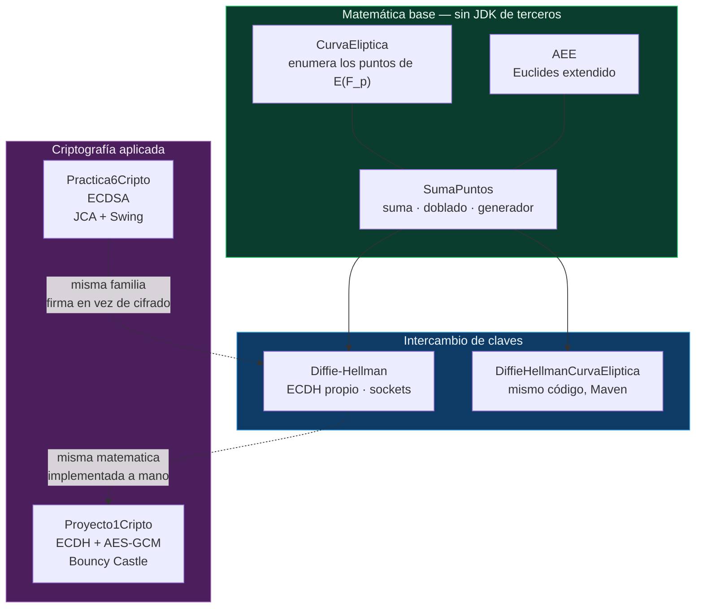
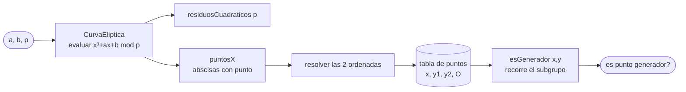
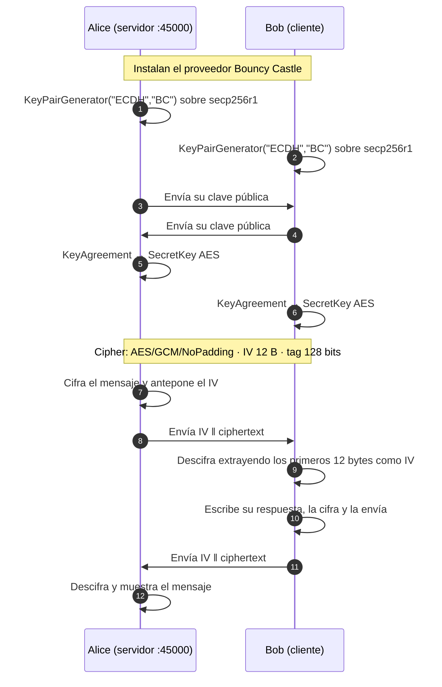
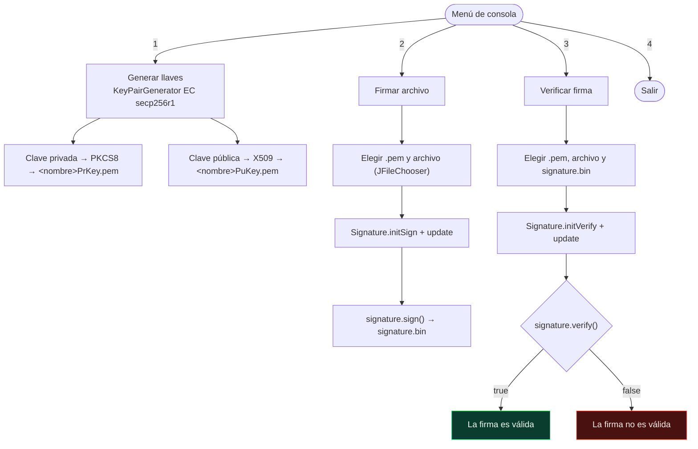

<div align="center">

# Temas Selectos de Criptografía

**Implementaciones en Java de criptografía de clave pública sobre curvas elípticas**

[](https://www.oracle.com/java/)
[](https://netbeans.apache.org/)
[](https://www.ipn.mx/)
[](LICENSE)
[](https://www.ipn.mx/)

Prácticas de la asignatura **Temas Selectos de Criptografía** — cursada en el
séptimo semestre de Ingeniería en Sistemas Computacionales.

</div>

---

## 📚 Contenido

| # | Proyecto | Tema | Primitive / Algoritmo | Build | Dependencias |
|:-:|:--|:--|:--|:--|:--|
| 1 | [`SumaPuntos/`](SumaPuntos/) | Álgebra de curvas elípticas | Suma y doblado de puntos, punto generador | Maven | — |
| 2 | [`Diffie-Hellman/`](Diffie-Hellman/) | Intercambio de claves ECDH (implementación propia) | ECDH sobre EC | Ant / NetBeans | — |
| 3 | [`DiffieHellmanCurvaEliptica/`](DiffieHellmanCurvaEliptica/) | El mismo ECDH, empaquetado con Maven | ECDH sobre EC | Maven | — |
| 4 | [`Proyecto1Cripto/`](Proyecto1Cripto/) | Cifrado híbrido: ECDH + AES-GCM | ECDH + `AES/GCM/NoPadding` | Ant / NetBeans | Bouncy Castle |
| 5 | [`Practica6Cripto/`](Practica6Cripto/) | Firma digital | ECDSA `SHA256withECDSA` | Ant / NetBeans | — |

Cada carpeta es un proyecto **independiente**: tiene su propio build, su propio
paquete y su propio `README`. El detalle de cada uno está en su carpeta.

---

## 🗺️ Mapa de proyectos



> Los proyectos 2 y 3 son **el mismo código** con distinto `package` y distinto
> sistema de build. Se conservan ambos tal como se escribieron; ver
> [Estado del repositorio](#-estado-del-repositorio).

---

## 🧮 Fundamentos

Toda la criptografía de este repositorio se apoya en un solo grupo: las
**curvas elípticas sobre un campo primo** $\mathbb{F}_p$.

### La curva

Una curva elíptica es el conjunto de pares $(x,y)$ que satisfacen

$$
y^2 = x^3 + ax + b \pmod p
$$

donde $p$ es primo y $4a^3 + 27b^2 \not\equiv 0 \pmod p$ (para que la curva no
sea singular). Los puntos, más un **punto al infinito** $\mathcal{O}$ que actúa
 como elemento neutro, forman un grupo abeliano bajo la operación de suma.

### Suma y doblado

Geométricamente ambas son *intersecciones con una recta*. El punto clave para
la criptografía es que la **pendiente $m$ exige dividir en $\mathbb{F}_p$**, y
la división se implementa multiplicando por el inverso modular:

$$
m = (y_2 - y_1)\,(x_2 - x_1)^{-1} \bmod p
$$

El inverso modular se obtiene con el **algoritmo de Euclides extendido**
(clase `AEE`), que devuelve los coeficientes $x,y$ tales que $a\,x + b\,y =
\gcd(a,b)$.

**Suma** de dos puntos distintos:

$$
x_3 = m^2 - x_1 - x_2 \bmod p
\qquad
y_3 = m\,(x_1 - x_3) - y_1 \bmod p
$$

**Doblado** $2P = P + P$, donde la pendiente de la tangente es $m = (3x^2 + a)\,(2y)^{-1} \bmod p$:

$$
x_3 = m^2 - 2x \bmod p
\qquad
y_3 = m\,(x - x_3) - y \bmod p
$$

> ⚠️ El punto de partida de ECDH y ECDSA es la **multiplicación escalar**
> $kP$, y aquí reside su seguridad: el orden de $k$ solo se conoce
> factorizando el número de puntos, lo que se reduce al
> **logaritmo discreto**, un problema para el que no se conoce solución
> con cómputo clásico (Shanks y Pollard $\rho$ son $O(\sqrt{n})$).

---

## 🔐 Las prácticas

### 1 · Suma de puntos en curvas elípticas → [`SumaPuntos/`](SumaPuntos/)

Herramienta de consola que, dada una curva $y^2 = x^3 + ax + b \bmod p$:

- enumera **todos** los puntos de $E(\mathbb{F}_p)$ (calculando los residuos
  cuadráticos de $p$ y cruzándolos con los valores de la curva);
- implementa **suma** y **doblado** de puntos;
- determina si un punto es **punto generador**, recorriendo el subgrupo que
  genera y comparando contra el total de puntos de la curva.



### 2 · ECDH sobre curva elíptica (propio) → [`Diffie-Hellman/`](Diffie-Hellman/) y [`DiffieHellmanCurvaEliptica/`](DiffieHellmanCurvaEliptica/)

Intercambio de claves completo entre dos procesos, **sin ninguna biblioteca de
criptografía**: la aritmética de la curva y el protocolo están implementados a
mano. Alice actúa como servidor y Bob como cliente sobre TCP.

```mermaid
sequenceDiagram
    autonumber
    participant A as Alice (servidor :45000)
    participant B as Bob (cliente)

    A->>A: Ingresa a, b, p y el punto generador G
    A->>B: Envía el objeto CurvaEliptica (Java serialization)
    B->>B: Elige su clave privada bPriv
    B->>B: Calcula B = bPriv · G
    B->>A: Envía B
    A->>A: Elige su clave privada aPriv
    A->>A: Calcula A = aPriv · G
    A->>B: Envía A
    Note over A,B: Secreto compartido
    A->>A: S = aPriv · B
    B->>B: S = bPriv · A
    Note right of A,B: aPriv·(bPriv·G) ≡ bPriv·(aPriv·G)
```

> El canal viaja **sin cifrar**: la confidencialidad del secreto viene de que
> $a$ y $b$ nunca se transmiten. Eso es precisamente lo que se busca demostrar.
> En la práctica faltaría autenticar a las partes (ECDHE autenticado) para
> resistir ataques de man-in-the-middle.

### 3 · Cifrado híbrido ECDH + AES-GCM → [`Proyecto1Cripto/`](Proyecto1Cripto/)

Sube el ejemplo anterior usando criptografía real: la curva elíptica solo
establece el secreto, y ese secreto se usa como llave de sesión para **cifrar
simétricamente** los mensajes con **AES en modo GCM**.



Detalles que importan:

- **GCM** es un modo *autenticado*: el tag de 128 bits va incluido en la salida
  de `doFinal`, así que un mensaje alterado falla al descifrar.
- El **IV no es secreto**, por eso viaja pegado al ciphertext: quien lo recibe
  lo necesita para descifrar. El código lo concatena con
  `System.arraycopy` en un solo arreglo.
- **Nunca se debe reutilizar un IV con la misma llave**: el código genera uno
  nuevo con `SecureRandom` en cada envío.

### 4 · Firma digital ECDSA → [`Practica6Cripto/`](Practica6Cripto/)

Generación de llaves, firma de archivos y verificación de la firma usando
`SHA256withECDSA` de la JCA, con las llaves exportadas a `.pem`.



La firma garantiza **autenticidad, integridad y no repudio**, pero no
confidencialidad: el archivo se firma tal cual, sin cifrar.

---

## 🚀 Cómo ejecutar

Cada carpeta es un proyecto aparte. Entra en la que quieras ejecutar.

**NetBeans** — abre la carpeta del proyecto y presiona <kbd>F6</kbd>
(*Run*). Los que usan sockets necesitan **dos terminales**: primero el
servidor (Alice) y luego el cliente (Bob).

**Consola con Maven** (proyectos 1 y 3):

```bash
cd SumaPuntos
mvn clean package
mvn exec:java
```

**Consola con Ant** (proyectos 2, 4 y 5):

```bash
cd Diffie-Hellman
ant run
```

> En `Diffie-Hellman` y `Proyecto1Cripto` el `main.class` declarado en
> `nbproject/project.properties` **no existe** (ver
> [Estado del repositorio](#-estado-del-repositorio)). Para lanzarlos desde
> consola hay que apuntar a la clase correcta:
>
> ```bash
> java -cp Diffie-Hellman/build/classes diffie.hellman.Alice
> java -cp Diffie-Hellman/build/classes diffie.hellman.Bob
> ```
>
> `Proyecto1Cripto` necesita además Bouncy Castle en el classpath:
>
> ```bash
> java -cp "Proyecto1Cripto/build/classes;./bcprov-jdk18on-173.jar" proyecto1cripto.Alice
> ```

### Puertos y datos que pide cada programa

| Proyecto | Puerto | Datos que hay que capturar por consola |
|:--|:-:|:--|
| `SumaPuntos` | — | `a`, `b`, `p`, y las coordenadas `x`, `y` del punto a probar |
| `Diffie-Hellman` | `45000` | Alice: `a`, `b`, `p`, `x`, `y` del generador, y su clave privada. Bob: su clave privada |
| `Proyecto1Cripto` | `45000` | Alice: el mensaje a enviar. Bob: el mensaje de respuesta |
| `Practica6Cripto` | — | menú numerado; el resto se elige con diálogos Swing |

---

## 🗂️ Estructura del repositorio

```
.
├── SumaPuntos/                    # proyecto 1 — Maven
├── Diffie-Hellman/                # proyecto 2 — Ant / NetBeans
├── DiffieHellmanCurvaEliptica/    # proyecto 3 — Maven (gemelo del 2)
├── Proyecto1Cripto/               # proyecto 4 — Ant / NetBeans + Bouncy Castle
├── Practica6Cripto/               # proyecto 5 — Ant / NetBeans
│
├── docs/                           # material del curso
│   ├── suma-de-puntos-en-curvas-elipticas.pdf
│   ├── practica-04-curva-eliptica-y-openssl.pdf
│   └── lightweight-cryptography-ii-sparkle.pdf
│
├── .github/                        # plantillas de issue y pull request
├── CONTRIBUTING.md
├── LICENSE
├── .gitignore
└── README.md
```

---

## 📄 Material del curso

Los enunciados y reportes de las prácticas están en [`docs/`](docs/).

| Documento | Qué es | Relación con el código |
|:--|:--|:--|
| [`suma-de-puntos-en-curvas-elipticas.pdf`](docs/suma-de-puntos-en-curvas-elipticas.pdf) | Reporte de la práctica de suma y doblado de puntos | Corresponde al proyecto 1 ([`SumaPuntos/`](SumaPuntos/)) |
| [`practica-04-curva-eliptica-y-openssl.pdf`](docs/practica-04-curva-eliptica-y-openssl.pdf) | *Curva elíptica criptográfica y OpenSSL* — listar curvas, generar parámetros y llaves en `.pem`/`.der`, firmar y verificar archivos | Base teórica del proyecto 5 ([`Practica6Cripto/`](Practica6Cripto/)), resuelto aquí en Java |
| [`lightweight-cryptography-ii-sparkle.pdf`](docs/lightweight-cryptography-ii-sparkle.pdf) | SPARKLE, finalista de NIST para criptografía ligera, escrito en **C** | Sin código Java en este repositorio; se conserva como referencia del temario |

---

## 👤 Autor

**Francisco Uziel Córdova Pichardo** — `@Uziel-Leizu`

 séptimo semestre de Ingeniería en Sistemas Computacionales, grupo 7CM2.
ESCOM, Instituto Politécnico Nacional.

---

## 📌 Estado del repositorio

Este repositorio se documenta **tal como está**: no se modificó el código de
ninguna práctica. Se registran aquí las observaciones que se detectaron al
documentarlo, para que quede la traza y puedan resolverse en una etapa posterior.

### Observaciones de código

- **Proyectos 2 y 3 son duplicados.** `Diffie-Hellman/src/diffie/hellman/` y
  `DiffieHellmanCurvaEliptica/src/main/java/com/studio/diffiehellmancurvaeliptica/`
  contienen las mismas cinco clases; la única diferencia entre archivo y archivo
  es la línea `package` y un comentario de cabecera de NetBeans. No aportan nada
  uno respecto del otro.
- **Las clases de curvas elípticas están duplicadas también entre el proyecto 1
  y el 2**, y no son idénticas: el proyecto 1 expone `x`, `y1`, `y2` y el
  método `esGenerador`, mientras que el 2 añade el campo `Generador`,
  `setGenerador`, `getP` y un despachador `sumarPuntos` que decide entre suma y
  doblado. Son dos linajes de la misma implementación.
- **Puntos de entrada declarados que no existen:**
  - `Diffie-Hellman`: `main.class=diffie.hellman.DiffieHellman` (las clases
    reales son `diffie.hellman.Alice` y `diffie.hellman.Bob`)
  - `Proyecto1Cripto`: `main.class=proyecto1cripto.Proyecto1Cripto` (no existe;
    las clases reales son `proyecto1cripto.Alice` y `proyecto1cripto.Bob`)
  - `DiffieHellmanCurvaEliptica`: `exec.mainClass` apunta a
    `…diffiehellmancurvaeliptica.DiffieHellmanCurvaEliptica` (las clases reales
    son `…diffiehellmancurvaeliptica.Alice` y `…Bob`)
- **Rutas absolutas de una máquina personal** en
  `Proyecto1Cripto/nbproject/project.properties` y
  `Practica6Cripto/nbproject/project.properties`: apuntan a
  `C:\Users\pakma\Downloads\` y a una carpeta de OneDrive. En el caso de
  `Practica6Cripto` son además **innecesarias**: su código solo usa la JCA
  (`KeyPairGenerator.getInstance("EC")`,
  `Signature.getInstance("SHA256withECDSA")`) y no importa Bouncy Castle, así que
  los ocho `.jar` de esa carpeta (~27 MB) no se usan.
- **Java inconsistente:** `javac.source/target` es `1.8` en `Diffie-Hellman` y
  `Proyecto1Cripto`, y `19` en los tres proyectos Maven y en `Practica6Cripto`.
- **Aritmética en `int` y `Math.pow`:** la implementación de la curva usa
  `int` y `(int) Math.pow(x, 2)`, con lo que desborda en cuanto `p` crece;
  una curva como `secp256r1` no cabe en `int`. El tipo correcto es `BigInteger`.
- **Otros detalles menores:** `Scanner` sin cerrar, separador de rutas
  hardcodeado (`"\\"`) en `Practica6Cripto`,
  `catch (Exception e) { e.printStackTrace(); }`, y el
  `ObjectOutputStream`/`BufferedWriter` mezclados sobre el mismo socket en los
  dos proyectos de ECDH.

Ninguno de estos puntos impide leer ni compilar las prácticas; se dejan
documentados en lugar de corregidos para no alterar los trabajos entregados.

---

<div align="center">
<sub>Hecho con ☕ por <a href="https://github.com/Uziel-Leizu">@Uziel-Leizu</a></sub>
</div>
