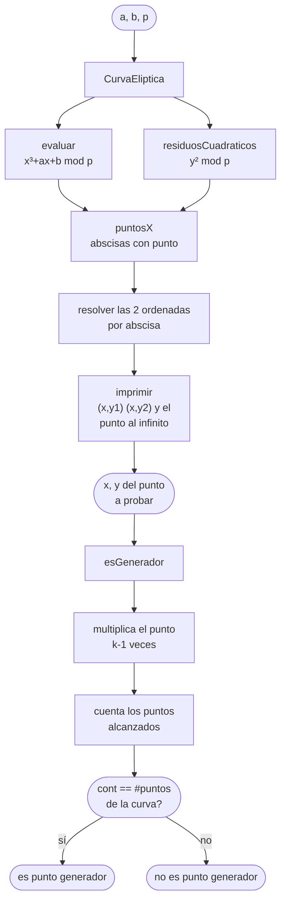

# Suma de puntos en curvas elípticas

<div align="center">

**Práctica 1 · Álgebra de curvas elípticas sobre $\mathbb{F}_p$**

[](https://www.oracle.com/java/)
[](https://maven.apache.org/)
[](https://maven.apache.org/)
[](../LICENSE)

`Temas Selectos de Criptografía` · Grupo 7CM2 · ESCOM · IPN

[← Volver al índice](../README.md)

</div>

---

## 📖 Contexto

Herramienta de consola que implementa la **ley de grupo** de una curva
elíptica sobre un campo primo: enumerar los puntos de la curva, sumar y doblar
puntos, y determinar si un punto dado es **punto generador**.

Es la base matemática de la que parten las otras dos prácticas del repositorio:
sin la suma de puntos no hay multiplicación escalar, y sin multiplicación
escalar no hay ECDH ni ECDSA.

El reporte de esta práctica está en [`docs/suma-de-puntos-en-curvas-elipticas.pdf`](../docs/suma-de-puntos-en-curvas-elipticas.pdf).

---

## 🧮 Qué hace

### 1 · Enumerar los puntos de la curva

Para cada $x \in [0, p-1]$ se calcula el residuo $r = x^3 + ax + b \bmod p$, y
ese $r$ tiene solución en $y$ **si y solo si** es un residuo cuadrático de $p$:

$$
\{y^2 \bmod p \;:\; y \in [1, \lfloor p/2 \rfloor]\}
$$

El código cruza ambos conjuntos en `puntosX` y luego resuelve las dos ordenadas
de cada abscisa en el constructor. Solo recorre $y$ hasta $p/2$ porque
$(-y)^2 \equiv y^2$, así que la mitad superior de residuos ya está cubierta.

### 2 · Suma y doblado

Ambas operaciones son una intersección con una recta, y ambas necesitan dividir
en $\mathbb{F}_p$. La división se resuelve multiplicando por el **inverso
modular**, que `AEE.euclidesExtendido` obtiene como segundo coeficiente:

$$
m = (y_2 - y_1)\,(x_2 - x_1)^{-1} \bmod p
\qquad
m = (3x^2 + a)\,(2y)^{-1} \bmod p
$$

**Suma** de dos puntos distintos $P + Q$:

$$
x_3 = m^2 - x_1 - x_2 \bmod p
\qquad
y_3 = m\,(x_1 - x_3) - y_1 \bmod p
$$

**Doblado** $2P$, con $m$ de la tangente:

$$
x_3 = m^2 - 2x \bmod p
\qquad
y_3 = m\,(x - x_3) - y \bmod p
$$

### 3 · Punto generador

Un punto $G$ es generador si su subgrupo tiene el mismo tamaño que el grupo
completo, es decir si $\mathrm{ord}(G) = \#E(\mathbb{F}_p)$. El método
`esGenerador` recorre el subgrupo contando cuántos puntos de la curva va
alcanzando, y devuelve `true` solo si los recorre todos.

---

## 🔄 Flujo



---

## 🚀 Cómo ejecutarlo

### NetBeans

Abre la carpeta `SumaPuntos` en NetBeans y presiona <kbd>F6</kbd>.

### Maven

```bash
cd SumaPuntos
mvn clean package
mvn exec:java
```

El `exec.mainClass` del `pom.xml` apunta a `com.studio.sumapuntos.SumaPuntos`,
que es la clase que contiene el `main`.

### Ejecución directa con `javac`

```bash
cd SumaPuntos
javac -d out $(find src -name "*.java")
java -cp out com.studio.sumapuntos.SumaPuntos
```

---

## 🎮 Cómo se usa

El programa pide los datos por consola:

```
Bienvenido al programa para calcular suma de puntos en Curvas Elipticas
Programa hecho por Leizu
---------------------------------------------------------------------------
Primero ingrese los datos de la curva eliptica a trabajar
Ingrese el valor de a:
Ingrese el valor de b:
Ingrese el valor de p:
```

Primero imprime la tabla completa de puntos de la curva, y después pide un punto
para determinar si es generador:

```
--------------------------------------------------
Puntos de la curva eliptica:
(1,6) (1,7)
(3,10) (3,11)
...
(Punto al Infinito)
--------------------------------------------------
Ingresa un punto para determinar si es generador
Ingresa x:
Ingresa y:
```

Ambos métodos de suma (`SumPun` y `DobPun`) van imprimiendo el punto
intermedio que calculan, así que la salida muestra la traza de la operación:

```
Vamos a doblar el punto
x3= 6 y3= 9
Puntos generados 9
es punto generador: true
```

---

## 🌳 Estructura

```
SumaPuntos/
├── pom.xml
└── src/main/java/com/studio/sumapuntos/
    ├── AEE.java              # Euclides extendido → inverso modular
    ├── CurvaEliptica.java   # modelo de la curva y enumeración de puntos
    ├── MaximoComunDivisor.java # MCD por Euclides
    └── SumaPuntos.java      # main + suma, doblado y esGenerador
```

| Clase | Responsabilidad |
|:--|:--|
| `AEE` | Algoritmo de Euclides extendido. Devuelve `[gcd, x, y]` con $a\,x + b\,y = \gcd(a,b)$; el coeficiente `x` es el inverso modular que necesitan las fórmulas de la curva. |
| `MaximoComunDivisor` | `MCD(a,b)` por división por tentativa. |
| `CurvaEliptica` | Guarda $a$, $b$, $p$ y **enumera todos los puntos**, exponiendo `x`, `y1`, `y2`. También `esPrimo`, `burbuja`, `evaluar`, `residuosCuadraticos`, `puntosX` e `imprimir`. |
| `SumaPuntos` | `SumPun`, `DobPun` y `esGenerador`, más el `main` que las orchestra. |

---

## 📚 Creditos

- **AEE** — la implementación de Euclides extendido corresponde a
  [makingcode.dev](https://www.makingcode.dev/2015/06/implementacion-de-euclides-extendido-en.html),
  de Andrés Esquivel.

---

## 👤 Autor

**Francisco Uziel Córdova Pichardo** — `@Uziel-Leizu`

---

## 📌 Notas sobre esta implementación

Se documentan sin modificar el código:

- **Aritmética en `int` y `Math.pow`.** La implementación usa `int` y
  `(int) Math.pow(x, 2)`, que desborda en cuanto `p` crece; el tipo correcto
  para una curva real (`secp256r1` y similares) es `BigInteger`.
- **`puntosY1()` está duplicado.** El constructor ya calcula `y1` e `y2`, y ese
  método vuelve a hacer exactamente lo mismo. No lo invoca la aplicación.
- **Nombres de API en español con mayúscula inicial** (`SumPun`, `DobPun`,
  `MCD`) y el `Scanner` nunca se cierra.
